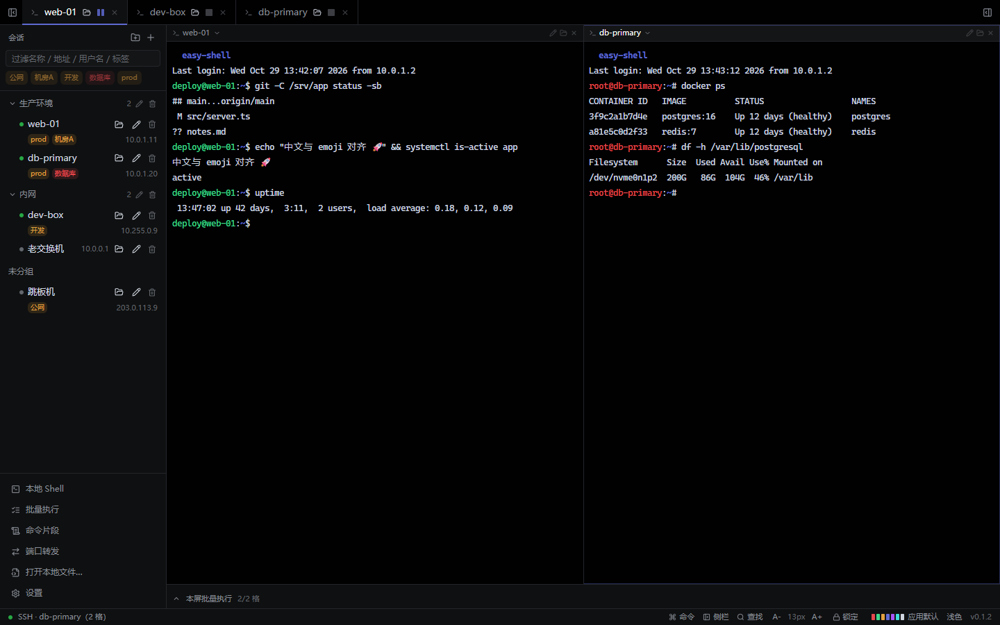
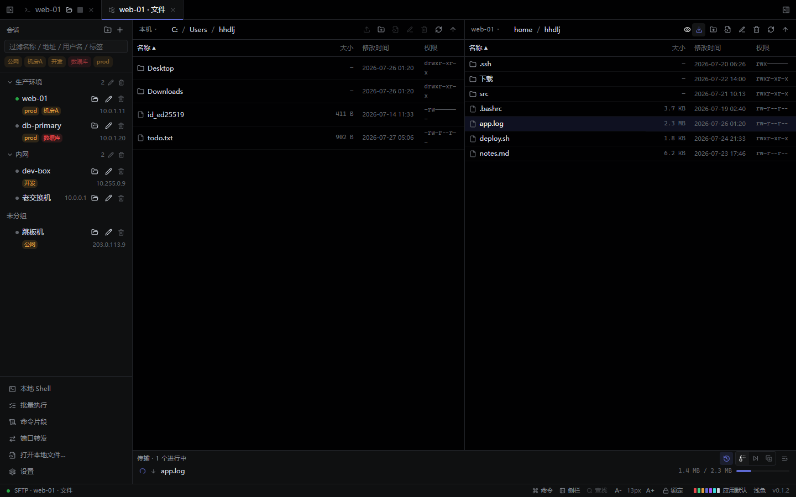
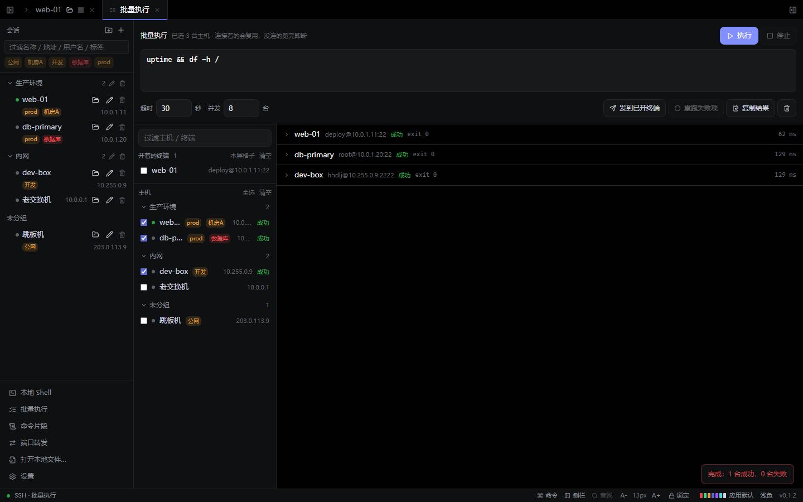
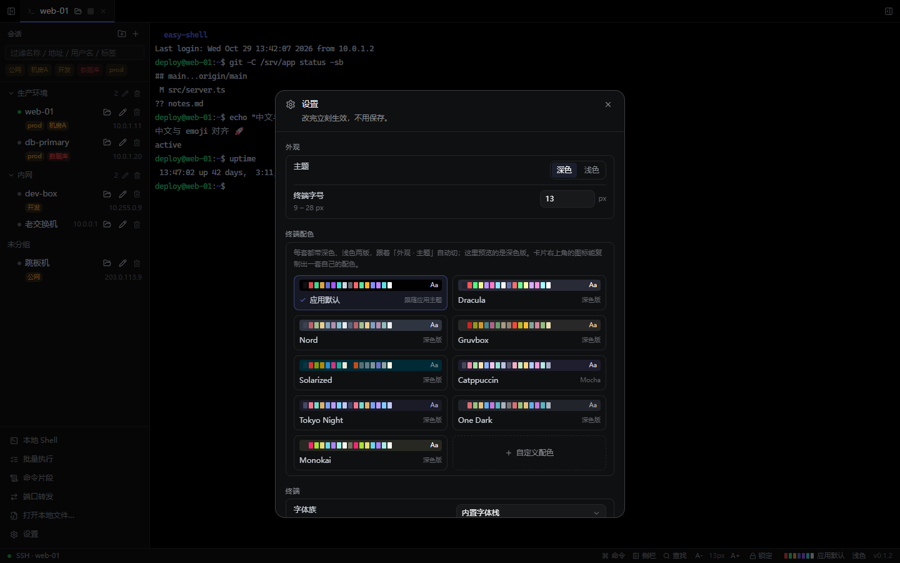
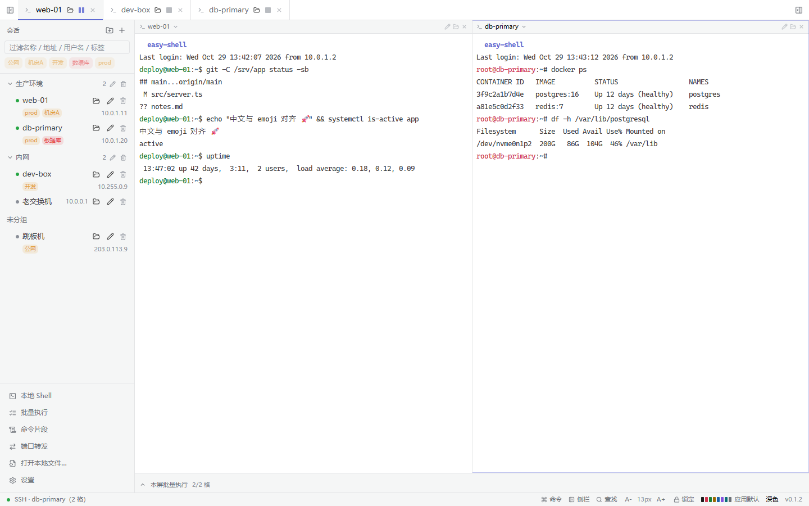

<div align="center">
  
  <h1>easy-shell</h1>
  <p><strong>够用且克制的 SSH + SFTP 客户端</strong></p>
  <p>终端、SFTP、会话管理。别的不做。</p>
  <p>
    
    
    
    
    
  </p>
</div>

> SSH 引擎是 **russh 纯 Rust 直连**，不依赖系统 `ssh.exe`；
> 终端仿真交给 xterm.js，Rust 只搬字节流。视觉规范取自 Linear，代码完全自有，目标是长期可维护。



<p align="center"><sub>左侧会话树 · 三个标签 · 左右分屏分别连到 web-01 与 db-primary</sub></p>

## 为什么做这个

- 日常运维离不开一个顺手的 SSH + SFTP 工具，但不少客户端已经停止维护。
- 商业客户端越来越重：账号体系、云同步、插件市场、AI 助手……真正每天用的还是终端和文件传输。
- 所以 easy-shell 只做三件事：**连上机器、开终端、传文件**。加上会话管理，到此为止。

项目是 Windows 优先的个人项目，目前 `0.1.x`，界面和交互仍会调整；但底层连接、加密、
文件传输这些「改起来代价大」的部分已经按长期使用的标准实现。

## 功能

### 终端与分屏

- **xterm.js 5.5 + WebGL** 渲染，上下文丢失时自动回退 Canvas；中文与 emoji 宽字符对齐。
- **一个标签最多 4 格**，16 种预设排布（左右二分、上下二分、三列、四宫格、左一右二……），
  也可以直接拖拽切出任意形状。
- **每一格是独立 SSH 连接**，四宫格可以连四台不同的机器；点格子标题即可换主机。
- 拖格子换位、拖标签并进另一个窗口、拖分割线调比例；本地 Shell 也能和远程终端同屏。
- 终端内查找（高亮、区分大小写、上/下一个）、右键菜单、字号 9–28、回滚 500–100000 行。
- 断线自动重连，默认 3 次 / 间隔 2 秒，可在设置里关掉。
- 本地 Shell 走 Windows ConPTY；输出 UTF-8 优先，解不动时回退 GBK。

### SFTP

- **双栏文件管理**：左边本机、右边任一会话，或两边都是远程；从资源管理器拖文件进来即可上传。
- 上传、下载、**远程到远程流式中转**（不经过本地磁盘）。
- **断点续传**：用 `.part` 文件接着传，并用前 64 KB 做一致性校验。
- 同名文件三种策略：覆盖、跳过、保留两者；底部队列逐文件显示进度。
- 隐藏文件开关、按名称/大小/时间排序、新建目录、重命名、删除。
- 内置编辑器打开文本文件（UTF-8，≤ 2 MB），按文件名猜语言，Ctrl+S 保存。

### 会话管理

- 主机分组 + 标签 + 关键词过滤（名称、地址、用户名、标签任一命中）。
- 拖主机换分组；右键菜单支持连接、SFTP、批量执行、编辑、移动、复制、删除。
- 主机可自定义显示名与标签；**快速连接**不写进主机列表。
- `known_hosts` 使用 OpenSSH 格式 + TOFU；主机密钥变化时给出明确的「忘掉旧密钥并重连」。
- **兼容模式**：为老设备放开 `dh-group1/14-sha1`、`aes-cbc` 等已废弃算法。

### 效率工具

- **命令面板**（Ctrl+K）：新建会话、分屏、终端配色、锁定等命令一处搜索。
- **命令片段**：把常用命令存起来，一键发到当前聚焦的格子。
- **跨主机批量执行**：勾多台主机跑同一条命令，收每台的退出码、输出和耗时；
  支持并发、超时、只重跑失败项、复制结果。
- **本屏批量执行**：分屏底部那条，按格子投递，支持「执行」和「发送」、逐行模式。
- **本地端口转发 `-L`**：复用已认证的会话，不需要再开一条 SSH 连接。
- 全应用自绘右键菜单，统一的确认框与错误边界。

### 安全

- 主机、分组、片段存在本地 SQLite；凭据用主密码派生密钥加密
  （**argon2id + AES-256-GCM**）。
- **主密码可改**：旧密码当场重验，整个库在同一个事务里重新加密。
- 也可以**不设主密码**——但那只做了混淆，拿到 `vault.db` 就能读凭据，界面上会如实说明。
- **恢复密钥**：把库密钥封给一把 Ed25519 SSH 公钥，忘主密码时用对应私钥取回。
  只支持 Ed25519；安全性等同于那把私钥的保管强度。
- **锁定密钥库会断开所有连接**，不会留下已认证的会话。

### 外观

- 深色 / 浅色主题，Windows 原生标题栏跟着一起切换。
- 8 套内置终端配色，**每套都带深色、浅色两版**，跟着主题自动切换；可复制成自定义方案。
- 系统字体清单（Windows 读注册表，其他平台试 `fc-list`）；是否等宽用 canvas 量宽判断。
- 终端字号、行高、光标样式、回滚行数均可调。

## 界面

| SFTP 双栏 + 传输队列 | 跨主机批量执行 |
| --- | --- |
|  |  |

| 设置与终端配色 | 浅色主题 |
| --- | --- |
|  |  |

<sub>截图来自 `npm run dev:web` 的浏览器预览模式，使用内置演示数据。</sub>

## 快速开始

### 环境

- **Node.js 18+**
- **Rust 1.77.2+**
- **Visual Studio 2022**（MSVC 链接器 + Windows SDK）
- WebView2 Runtime（Windows 10/11 通常已自带）

### 开发

```bash
npm install

npm run tauri dev     # 桌面端开发（先起 vite 再开 webview）
npm run dev:web       # 浏览器预览：Tauri IPC 换成假数据，能在普通浏览器里看界面
```

`dev:web` 是为了让 UI 层（布局、主题、交互）能被自动化工具看到 —— Tauri 的原生 webview
够不着，没有这层假后端就只能靠人眼盯。

### 构建安装包

```bash
./tools/package.sh
```

前端构建 + Rust release + msi/nsis，约 3–5 分钟。产物在
`src-tauri/target/release/`（exe）与 `src-tauri/target/release/bundle/{msi,nsis}/`（安装包）。

> **Rust 编译必须走 `tools/build.sh`**：Git Bash 的 `/usr/bin/link.exe` 会顶替 MSVC 的
> `link.exe`，且 MSVC 需要 `LIB` 指向 SDK 的 `um/ucrt`。脚本顶部硬编码了 VS 2022 的四个路径，
> VS 安装位置不同时要改那四个变量。

如果 [Releases](https://github.com/DaPiHai/easy-shell/releases) 里已经有对应版本的安装包，
也可以直接下载安装。安装包未做代码签名，Windows SmartScreen 可能提示「未知发布者」。

### 质量闸门

```bash
npm run typecheck         # 前端类型检查（没配 eslint/prettier，这就是唯一闸门）
npm run check:commands    # 后端命令注册 ↔ api.ts 包装 ↔ 预览 mock 三方对齐
npm run check:layout      # 分屏排布：穷举「形状 × 格 × 落点」
./tools/build.sh test     # Rust 测试（100 个单元 + 29 个集成）
```

集成测试会起**真实的 SSH / SFTP / PTY 服务端**，不是 mock 假 SSH；改连接、传输、
本地 Shell 这些链路时必须跑对应测试。真机验证默认跳过，设置
`EASY_SHELL_VERIFY_HOST/_USER/_PASS` 后运行 `./tools/build.sh test --test real_server -- --nocapture`。

## 快捷键

| 按键 | 动作 |
| --- | --- |
| `Ctrl K` | 命令面板 |
| `Ctrl N` | 新建会话 |
| `Ctrl W` | 关闭当前标签（输入框或终端内让路） |
| `Ctrl Tab` / `Ctrl Shift Tab` | 切换标签 |
| `Ctrl Shift B` | 收起 / 展开会话侧栏 |
| `Ctrl Shift F` | 终端内查找 |
| `Ctrl =` / `Ctrl -` / `Ctrl 0` | 放大 / 缩小 / 复位终端字号 |
| `Ctrl Shift C` / `Ctrl Shift V` | 终端复制 / 粘贴 |
| `Ctrl Enter` | 批量执行 |
| `Ctrl S` | 编辑器保存 |
| `Esc` | 关闭弹窗 / 取消拖拽 |
| 中键点标签 | 关闭标签 |

## 架构

```
React 前端  ──Tauri IPC（invoke + Channel）──  Rust 核心  ──russh / russh-sftp / portable-pty──  远端
```

三条约束：

1. **一条 SSH 连接复用**终端、SFTP、端口转发，不为每个功能单独建连。
2. **前端不持有连接状态**，连接、凭据、通道全在 Rust 侧 state 管理器，前端只有 id + 事件流。
3. **所有长耗时操作走 Tauri `Channel` 推事件**，不用轮询。

### Rust 侧（`src-tauri/src/`）

| 模块 | 职责 |
| --- | --- |
| `ssh.rs` | 会话 / 通道状态，`ShellCmd` 驱动每通道一个 tokio 任务 |
| `sftp.rs` | SFTP 子系统，以及全部本地文件操作 |
| `local.rs` | 本地 Shell（`portable-pty` / ConPTY） |
| `decode.rs` / `batcher.rs` | 输出解码（UTF-8 / GBK）与按帧攒批 |
| `tunnel.rs` | 本地端口转发 `-L` |
| `store.rs` | SQLite 持久化 + `Vault`（argon2id / AES-256-GCM） |
| `recovery.rs` | 恢复密钥（Ed25519 → X25519 ECDH + HKDF + AES-GCM） |
| `known_hosts.rs` | OpenSSH 格式 known_hosts + TOFU |
| `fonts.rs` | 系统字体清单 |

### 前端（`src/`）

- `lib/api.ts` —— 所有 Tauri 调用的唯一出口，每个后端命令对应一个包装函数。
- `lib/store.ts` —— 单个 zustand store，持有标签、分屏、传输队列、主题、密钥库状态。
- `lib/tauriMock.ts` —— 只在 `vite --mode web` 生效的假后端，用来跑浏览器预览与自动化。
- `features/` —— `terminal/`、`sftp/`、`session/`、`palette/`、`editor/`、`snippets/`、
  `tunnel/`、`batch/`、`settings/`、`panel/`。
- `styles/tokens.css` —— 深/浅主题的 CSS 变量。

## 已知限制

- **Windows 优先**。代码保持跨平台，但 macOS / Linux 尚未适配和验证。
- 认证只支持**密码 / 私钥（含 passphrase）**；不支持 keyboard-interactive（OTP/MFA）、
  ssh-agent、ProxyJump / SOCKS / ProxyCommand。
- 端口转发只有本地 `-L`；没有 `-R` / `-D`，规则只存在内存里，重启即失。
- 传输队列串行，暂不支持取消 / 暂停；也不能把文件从应用拖出到资源管理器。
- 标签和窗口布局不跨启动恢复；没有托盘、自动更新、会话日志落盘。
- 内置编辑器只处理 UTF-8、≤ 2 MB；符号链接、远端权限修改尚未支持。
- 安装包未做代码签名。

更完整的缺口与优先级见 [TODO.md](TODO.md)。

## 文档

| 文件 | 内容 |
| --- | --- |
| [TODO.md](TODO.md) | 已完成之外的功能缺口，按优先级排序（唯一待办清单） |

## 致谢

- [Tauri](https://tauri.app/)、[React](https://react.dev/)、[Vite](https://vite.dev/)、
  [Tailwind CSS](https://tailwindcss.com/)
- [russh](https://github.com/Eugeny/russh) / [russh-sftp](https://github.com/AspectUnk/russh-sftp)、
  [portable-pty](https://github.com/wez/wezterm/tree/main/pty)、[xterm.js](https://xtermjs.org/)
- [CodeMirror](https://codemirror.net/)、[cmdk](https://cmdk.paco.me/)、[lucide](https://lucide.dev/)
- 设计语言参考 [Linear](https://linear.app/)

## 许可证

本仓库尚未声明开源许可证。如需在其它项目中使用、分发或二次开发，请先联系作者。
